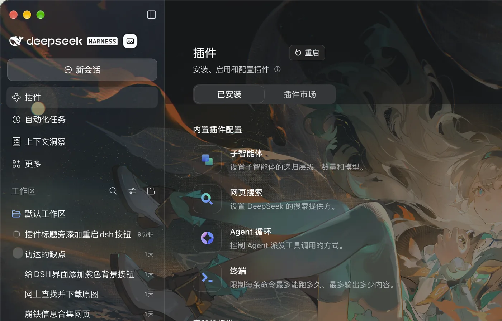

# dsh-restart

在 [DeepSeek Harness](https://github.com/deepseek-ai) 的插件页标题右侧加一个「重启」小按钮：点一下重启 DSH，插件改动立刻生效，不用退出再手动打开。



## 功能

- **标题右侧的小按钮**：注册在 `shell.overlay` 槽位，按插件页标题实测定位，紧贴「插件」右侧——不占用、不替换任何内置控件；离开插件页自动隐藏，标题滚进紧凑头部时一起收起
- **一键重启**：桌面版会关闭当前应用、等旧进程全部退出、重新启动，并确认应用真的回到前台
- **终端也能用**：在终端跑 `dsh web` 时，用完全相同的命令和参数重启 Host
- **跟随主题与语言**：只引用 `--dsw-alias-*` 主题变量，界面文案跟随 DSH 中英文
- **纯 JavaScript**：没有构建步骤，也没有运行时依赖

## 安装

1. 打开 DSH → **插件** → **添加插件**
2. 填入本仓库地址：

   ```text
   https://github.com/VictorGol/dsh-restart
   ```

3. 确认安装。按钮出现在「插件」页标题右侧；如果没出现，重开一次 DSH

需要 DSH 0.2.x 桌面版。

## 使用

点「重启」：窗口会关闭，几秒后自动重新打开并回到前台。正在运行的任务会被中断——这一点和菜单里的退出重启一致。

## 实现

- **按钮定位**：插件页没有标题旁的槽位，所以按钮注册在 `shell.overlay`，读取页面标题 `[data-plugin-header-part="title"]` 的位置贴在它右侧，用 `MutationObserver` + `resize` 重新测量；标题不存在时按钮不渲染
- **Host 路由**：`POST /dsh-restart/restart`，只接受 loopback 请求；自定义请求头跨域会触发预检，而该路径不响应预检，别的网页发不出这个请求；同一时间只允许一次重启（第二次 409）
- **detached helper**：点击后 Host 启动一个脱离进程组的 helper，自己随即退出，所以后续步骤不会被正在重启的进程带走。helper 依次：
  1. 等旧应用的所有进程（主进程、渲染进程、Host）退出，再等 1.2 秒让单实例锁释放；
  2. 从环境里剥掉 `ELECTRON_RUN_AS_NODE`、`DSH_SESSION_ID`、`DSH_WEB_URL` 等只属于 Host 的变量——`open` 会把这些变量原样传给被启动的 App，而 `ELECTRON_RUN_AS_NODE=1` 会让 Electron 以 Node 模式启动：没有窗口、约 0.1 秒退出；
  3. `open -a` 启动，3.5 秒后确认应用进程真的存在；没起来就重试（最多 5 次，第 4 次直接执行应用可执行文件）；
  4. 再发一次 `open -a` 触发应用的 `activate`，把窗口带到前台。
- **日志**：每一步都写进 `$TMPDIR/dsh-restart.log`，重启失败时先看这里。

## 兼容性

- macOS 桌面版 DSH 0.2.x：实测通过（点按钮后窗口关闭，约 4 秒后重新打开）
- Windows 桌面版 DSH 0.2.x：实测通过（直接执行应用可执行文件；该平台没有 `ps` 校验，所以只有一次启动尝试，起来后应用自己恢复窗口）
- 终端 `dsh web`：按原命令重启 Host（未在真机单独验证）

## 卸载

在插件页卸载即可；不需要清理其他状态。

## License

MIT · 详见 [LICENSE](LICENSE)

---

## English

A small **Restart** button beside the Plugins page title in DeepSeek Harness. One click relaunches the app so plugin changes take effect without quitting and reopening it by hand.

- **The button** is registered in the `shell.overlay` slot and anchored to the page title, so it sits next to the heading without replacing any built-in control. It disappears when you leave the Plugins page or the header collapses on scroll.
- **Desktop**: stops the running app, waits for every one of its processes to exit, starts it again, confirms it is really running and activates its window.
- **Terminal `dsh web`**: replays the same command and arguments once the old Host released its port.
- Plain JavaScript, no build step, no runtime dependencies.

### Install

1. Open DSH → **Plugins** → **Add plugin**
2. Paste `https://github.com/VictorGol/dsh-restart`
3. Confirm. The button appears right of the Plugins title; if it does not, reopen DSH once.

Requires DSH 0.2.x desktop.

### How it works

The click sends `POST /dsh-restart/restart` (loopback only, custom-header fenced). The Host then spawns a detached helper and exits; the helper waits for the old application's processes to disappear, strips Host-only environment variables — `open` forwards the caller's environment, and `ELECTRON_RUN_AS_NODE=1` would start the app as Node with no window — launches it, verifies the process exists (retrying up to five times), and finally activates the window. Every step is logged to `$TMPDIR/dsh-restart.log`.

### Compatibility

Verified on the macOS and Windows desktop apps (DSH 0.2.x). On Windows the helper launches the executable directly and cannot verify the result, so it makes a single launch attempt; the application restores its own window.

## License

MIT
